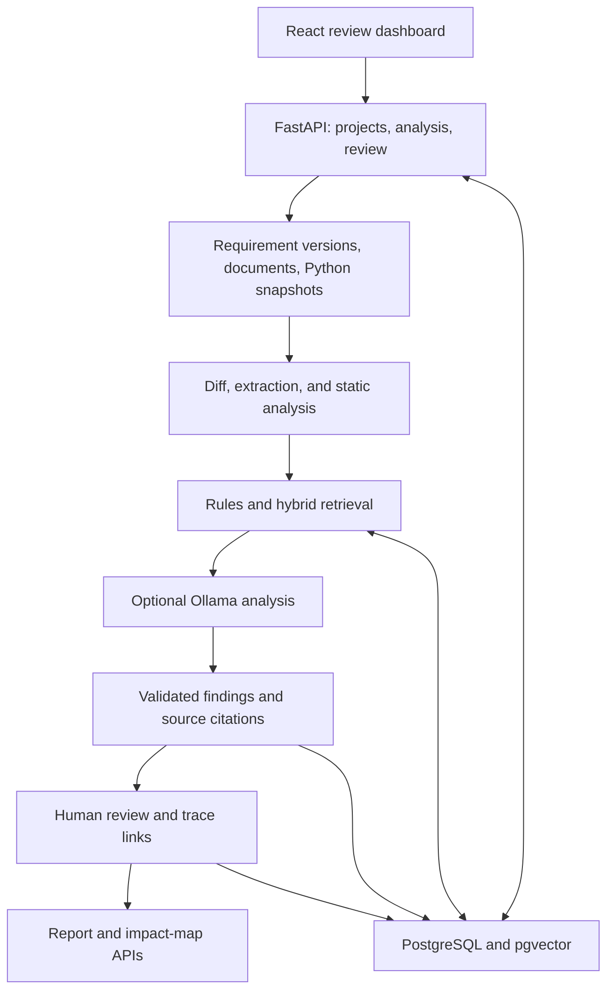

<div align="center">


# ChangeLens AI

**Requirement changes. Traceable impact. Human decisions.**

[](https://github.com/Aymanelgr/changelens-ai/actions/workflows/ci.yml)


[Features](#features) � [Architecture](#architecture) � [Quick start](#quick-start) � [Roadmap](docs/ROADMAP.md) � [Contributing](CONTRIBUTING.md)

</div>

ChangeLens AI helps reviewers answer a practical question: **when a requirement changes, which documents, code, and tests need attention?** It compares requirement versions, proposes affected items with source citations, and records the reviewer's decision in an audit trail.

For example, a bank lowers its extra-verification threshold from **10,000 MAD to 5,000 MAD**. ChangeLens looks for the old threshold in documentation and Python code, proposes related functions and tests for review, and suggests boundary cases. A reviewer inspects the evidence, then accepts, rejects, or corrects each proposal.

**Work in progress:** this final-year engineering project (PFE) uses synthetic banking examples. Features are evolving; see the [roadmap](docs/ROADMAP.md) for what is implemented and what still needs validation.

## Features

| Area | Implementation |
|---|---|
| Requirement comparison | YAML requirement sets, stable identifiers, word-level differences, and structured change facts |
| Document reading | Markdown, UTF-8 text, and text-based PDFs with section or page citations; scans marked as needing OCR |
| Code analysis | Python ZIP snapshots, AST-based symbols and calls, explicit references, threshold checks, and unresolved-call reporting |
| Retrieval | PostgreSQL full-text search and pgvector embeddings; keyword fallback when embeddings are unavailable |
| Local AI | Ollama impact analysis, validated model output, checked source quotations, and a fallback when the LLM is unavailable |
| Human review | Accept, reject, or correct findings; trace links, evidence history, and reopened reviews when evidence changes |
| Test suggestions | Boundary cases derived from changed requirement facts, kept separate from executed tests |
| Reporting | Markdown and HTML report endpoints, plus an impact-map API linking requirements to documents, code, and tests |
| Access and audit | JWT authentication, project-scoped admin/analyst/reviewer/viewer roles, protected audit history, and controlled project deletion |

Findings are review proposals. They do not prove compliance or automatically change source files.

## Architecture



The default setup runs models locally: **Qwen3 8B** through Ollama and **BGE-M3** for embeddings. First use can download model weights. Analysis runs as a background task inside the API process, with inputs, findings, and decisions persisted in PostgreSQL. Report and impact-map endpoints are implemented; their dashboard integration is still pending.

## Quick start

Requires Git, Docker Desktop with Compose, Python **3.12+**, and enough memory for the selected models. The Python setup scripts use the standard library; application dependencies run in containers.

1. Clone the project and generate your local configuration:

   ```powershell
   git clone https://github.com/Aymanelgr/changelens-ai.git
   cd changelens-ai
   python scripts/generate_env.py
   ```

   The script generates random database, JWT, and administrator secrets in `.env`. It preserves an existing configuration. Keep that file private.

2. Build and start the application:

   ```powershell
   docker compose up -d --build
   ```

3. Download the default local LLM:

   ```powershell
   docker compose exec ollama ollama pull qwen3:8b
   ```

   BGE-M3 downloads on the first embedding-enabled analysis. For a lighter setup, set `LLM_PROVIDER=none` and `EMBEDDING_PROVIDER=none` in `.env`, then run `docker compose up -d`. Rules and keyword search remain available.

4. Once the API is ready, load the synthetic banking example:

   ```powershell
   python scripts/seed_demo.py
   ```

5. Open the dashboard and sign in:

   | Service | Address |
   |---|---|
   | Dashboard | [http://127.0.0.1:8080](http://127.0.0.1:8080) |
   | Interactive API docs | [http://127.0.0.1:8000/docs](http://127.0.0.1:8000/docs) |
   | API health | [http://127.0.0.1:8000/health](http://127.0.0.1:8000/health) |

   The default administrator is `admin@demo.local`; its password is `BOOTSTRAP_ADMIN_PASSWORD` in `.env`. After seeding, `analyste@demo.local`, `relecteur@demo.local`, and `lecteur@demo.local` use the same demo password.

**Try the demo:** open the bank project, open its change request, choose **Lancer l'analyse**, inspect the evidence, review findings, and read the audit history. The dashboard currently uses French labels.

<details>
<summary><strong>Optional NVIDIA GPU support</strong></summary>

With a compatible NVIDIA setup in Docker Desktop:

```powershell
docker compose -f docker-compose.yml -f docker-compose.gpu.yml up -d --build
```

To reuse an existing Ollama model folder, set `OLLAMA_MODELS_DIR` in `.env`; see [.env.example](.env.example).

</details>

The Compose setup binds the dashboard, API, and database to localhost. Ollama is reachable within the Docker network. GitHub stores the source; hosting the application publicly requires a separate deployment configuration.

## Development and validation

Use Python **3.12+** for the backend and Node.js **24** to match frontend CI. Keep Docker services running while developing. For a local frontend connected to the containerized API:

```powershell
cd frontend
npm ci
npm run dev
```

Open [http://127.0.0.1:5173](http://127.0.0.1:5173). Vite forwards `/api` requests to the backend on port 8000.

Backend checks, from the repository root:

```powershell
# Create the separate test database once, using the generated default database user.
docker compose exec db createdb -U changelens changelens_test

cd backend
python -m venv .venv
.venv\Scripts\python -m pip install -r requirements-dev.txt
.venv\Scripts\python -m ruff check .
.venv\Scripts\python -m ruff format --check .
.venv\Scripts\python -m pytest --cov=app
```

Tests read database credentials from the root `.env` and use `changelens_test` on port 5433, or an explicit `TEST_DATABASE_URL`. Integration tests rebuild the test schema and require a disposable PostgreSQL/pgvector database with the necessary schema and trigger permissions. Model calls are replaced with test doubles; passing tests does not validate live-model accuracy.

Frontend production check, from the repository root:

```powershell
cd frontend
npm ci
npm run build
```

[CI](https://github.com/Aymanelgr/changelens-ai/actions/workflows/ci.yml) runs backend linting, formatting, tests with a critical-module coverage threshold, the frontend build, secret scanning, and Docker image builds.

## Repository guide

| Path | Purpose |
|---|---|
| `backend/app/core/` | Configuration, database, authentication helpers, and shared types |
| `backend/app/modules/` | Projects, ingestion, extraction, requirements, code analysis, indexing, analysis, review, reporting, and audit |
| `backend/app/llm/` | Model clients, prompts, and response validation |
| `backend/migrations/` | Versioned PostgreSQL schema changes |
| `backend/tests/` | Unit tests and PostgreSQL integration tests |
| `frontend/` | React, TypeScript, and Vite review dashboard |
| `demo-data/` | Synthetic requirements, documents, and Python banking code |
| `scripts/` | Environment generation, demo data, and PDF fixture generation |
| `evaluation/` | Reserved for reproducible evaluation datasets and results |
| `docs/` | Roadmap, learning journal, and specification decisions |

## Current limits

- Static Python analysis is approximate. Dynamic calls, dependency injection, and indirect constant use can leave missing links; unresolved calls are reported.
- Scanned PDFs are stored and flagged for OCR, but OCR is not implemented.
- Suggested tests are proposals and are never executed by the platform.
- Restarting the API interrupts active analyses, which are marked as failed on startup.
- Python files have a 1 MB size cap in place of a per-file parsing timeout.
- Live-model evaluation and a reproducible evaluation dataset are still pending. Synthetic examples do not establish real-world accuracy.

## Continuing development

Keep working in this checkout and push updates when ready. See [CONTRIBUTING.md](CONTRIBUTING.md) for the branch, validation, commit, and push workflow, and the [roadmap](docs/ROADMAP.md) for next steps.

For the reasoning behind the implementation, read the [learning journal](docs/LEARNING_JOURNAL.md) and [specification decisions](docs/SPEC_DEVIATIONS.md). These notes include earlier development stages; the current source and setup instructions above take precedence.
